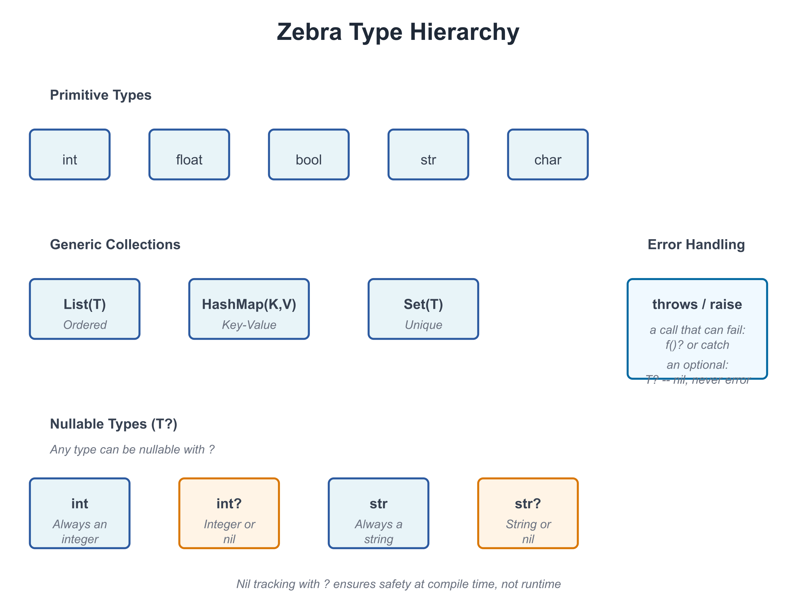

# 02: Values and Types

**Audience:** All  
**Time:** 90 minutes  
**Prerequisites:** 01-Getting-Started  
**You'll learn:** Zebra's type system, declaring variables, type inference, value vs. reference semantics

--- 

## The Big Picture

Every value in Zebra has a **type**. The type tells you:
- What kind of data it holds
- What operations you can perform on it
- How much memory it uses
- Whether it can be `nil`

Zebra's type system is **your best friend**—it catches mistakes at compile time instead of in production.



---

## Basic Types

### Integers

```zebra
# file: 02_integers.zbr
# teaches: integer types, arithmetic
# chapter: 02-Values-and-Types

def main()
    var age = 25
    var population = 8_000_000_000     # Underscores for readability
    var tiny: int8 = 100               # explicit narrow type
    var huge: int64 = 9_223_372_036_854_775_807

    print(age)
    print(population)
    print(tiny)
    print(huge)
```

**Integer types:**
- `int` — Default integer (usually 64-bit)
- `int8`, `int16`, `int32`, `int64` — Specific sizes
- `uint`, `uint8`, etc. — Unsigned (non-negative) integers

**Arithmetic:**
```zebra
var x = 10
var y = 3
print(x + y)  # 13
print(x - y)  # 7
print(x * y)  # 30
print(x / y)  # 3 (integer division)
print(x % y)  # 1 (remainder)
```

### When a Result Doesn't Fit: Overflow

Every integer type has a range — a `byte` holds 0 to 255, an `int8` holds -128 to 127, an
`int` holds about ±9.2 × 10¹⁸. If `+`, `-` or `*` produces a value outside the range, the
program **stops** rather than carry on with a wrong number:

```zebra
# file: 02_overflow_trap.zbr
# teaches: integer overflow stops the program
# chapter: 02-Values-and-Types

def add_ten(b: byte): byte
    return b + 10

def main()
    print(add_ten(100))    # 110
    print(add_ten(250))    # 260 does not fit in a byte: the program stops here
    print("not reached")
```

```text
110
thread 20484 panic: integer overflow
```

This holds in every build, including `zebra --release` — an optimised program does not
quietly wrap. When wrapping or clamping is what you *want* (hashes, checksums, colour
channels, counters that roll over), say so with an operator:

```zebra
# file: 02_wrap_saturate.zbr
# teaches: wrapping (+% -% *%) and saturating (+| -| *|) arithmetic
# chapter: 02-Values-and-Types

def main()
    var b: byte = 250
    print(b +% 10)     # 4    -- wraps around past 255
    print(b +| 10)     # 255  -- saturates: clamps at the top
    var s: int8 = -128
    print(s -| 1)      # -128 -- clamps at the bottom
    print(-%s)         # -128 -- wrapping negation
```

| | wraps around | clamps at the bounds |
|---|---|---|
| add, subtract, multiply | `+%` `-%` `*%` | `+\|` `-\|` `*\|` |
| negate / shift left | `-%x` | `<<\|` |
| compound forms | `+%=` `-%=` `*%=` | `+\|=` `-\|=` `*\|=` `<<\|=` |

They are Zig's operators with Zig's spelling, and they work on integers only.

### Mixing Integer Types

When two different integer types meet in arithmetic, the result is the **wider** type —
the same rule for `+ - * / %`, for `& | ^`, and for the wrapping and saturating forms:

```zebra
# file: 02_mixing_ints.zbr
# teaches: how two integer types combine
# chapter: 02-Values-and-Types

def main()
    var b: byte = 250
    var n: int = 1000
    var t: int8 = -5
    print(b + n)       # 1250 -- byte with int is an int
    print(b + t)       # 245  -- byte with int8 is an int16 (a signed type that holds both)
    print(b + 3)       # 253  -- a plain literal takes the other side's type
```

Three things the compiler refuses, each with a message naming the fix:

- **A literal that does not fit the other side.** `k + 300` with a `byte` `k` — 300 is not a
  byte. The check is by value, so `k + (300 - 200)` is fine and `k + 100 * 3` is not.
- **A result that would have to narrow on its own.** `b = b + n` with a byte `b` and an int
  `n` produces an int, and an int does not fit back into a byte silently. Convert it
  yourself (see *Narrowing* below).
- **`uint` beside a signed type.** No signed type holds every `uint` value, so `u + n` asks
  you to convert one side first.

```text
error: 300 does not fit in 'byte' (0..255), the type of the other operand of '+'
error: type mismatch: expected byte, found int -- an int does not narrow to a byte on its own; use `.toByte()` (low 8 bits)
error: cannot mix 'uint' and 'int' in arithmetic: no signed type holds every uint value -- convert one side first (`.toInt()` on the uint, checked)
```

### Literal Suffixes

A suffix gives a literal its type, and the variable it initialises takes that type too:

```zebra
# file: 02_literal_suffixes.zbr
# teaches: typed literals
# chapter: 02-Values-and-Types

def main()
    var a = 300_i16        # an int16
    var b = 5_u8           # a byte (uint8)
    var c = 7u             # a uint -- the underscore is optional
    var mask = 0xFF_u8     # hex works the same way
    var f = 1.5_f32        # a float32
    print(a)               # 300
    print(b +% 255_u8)     # 4 -- b really is a byte, so this wraps at 255
    print(c)               # 7
    print(mask)            # 255
    print(f)               # 1.5
```

Integer suffixes are `_i` and `_u` (the 64-bit `int` and `uint`) or either with a width —
8, 16, 32, 64 or 128. The literal must fit its type: `300_u8` and `128_i8` are refused
(`-128_i8`, int8's minimum, is fine). Two spellings look alike and are not: in a decimal
number a bare `_16` is a **digit separator** (`300_16` is 30016), while in hex a bare size
is the **signed type** (`0xFF_32` is 255 as an `int32`).

### Floating Point

```zebra
# file: 02_floats.zbr
# teaches: float types, precision
# chapter: 02-Values-and-Types

def main()
    var pi = 3.14159
    var precise: float64 = 3.141592653589793

    print(pi)
    print(precise)

    # Arithmetic
    var result = pi * 2.0
    print(result)
```

**Float types:**
- `float` — Default floating point (usually 64-bit)
- `float32`, `float64` — Specific precision

### Booleans

```zebra
# file: 02_bools.zbr
# teaches: boolean values, logic
# chapter: 02-Values-and-Types

def main()
    var is_ready = true
    var is_finished = false

    print(is_ready)
    print(is_finished)

    # Logic
    print(true and false)  # false
    print(true or false)  # true
    print(not true)  # false
```

### Strings

```zebra
# file: 02_strings.zbr
# teaches: string type, string operations
# chapter: 02-Values-and-Types

def main()
    var greeting = "Hello"
    var name = "World"

    print(greeting)
    print(greeting.len)  # 5
    print(greeting.upper())  # HELLO
    print(name.lower())  # world

    # Concatenation
    var message = greeting.concat(" ").concat(name)
    print(message)  # Hello World
```

**String methods** (we'll cover these fully in Chapter 06):
- `.len` — Length
- `.upper()` — Uppercase
- `.lower()` — Lowercase
- `.concat()` — Concatenate
- `.contains()` — Check for substring
- `.split()` — Split by delimiter

### Tuples — Multi-Value Bundles

A **tuple** holds two or more values of possibly different types, packed
together. Useful for returning multiple results from a function or
pairing values without writing a struct.

```zebra
# file: 02_tuples.zbr
# teaches: tuple types, literals, destructuring, and indexing
# chapter: 02-Values-and-Types

def minmax(a: int, b: int): (int, int)
    if a < b
        return (a, b)
    return (b, a)

def main()
    # Positional destructure into named locals
    var (lo, hi) = minmax(7, 3)
    print(lo)  # 3
    print(hi)  # 7

    # Hold as a tuple value, index into it
    var t = minmax(1, 9)
    print(t.0)  # 1
    print(t.1)  # 9

    # Mixed types work — (str, int), (float, bool), etc.
    var pair: (str, int) = ("alice", 42)
    print(pair.0)  # alice
    print(pair.1)  # 42
```

**Rules:**

- A tuple **type** uses parens with commas: `(int, int)`, `(str, int)`, `(float, bool, bool)`.
- A tuple **literal** uses the same syntax: `(7, 3)`, `("alice", 42)`.
- **Destructure** with `var (x, y) = expr` — binds names positionally.
- **Index** with `.0`, `.1`, `.2` (integer literal after `.`, zero-based).
- For lists of tuples (`List((str, int))`), the for-loop `for k, v in list` destructures automatically — see Chapter 03.

Tuples are the right tool when the pair is **transient** (returning
two values from one function) or **structural** (a coordinate pair).
For values you'll pass through many functions or attach methods to,
a `struct` (Chapter 07b) reads better.

---

## Declaring Variables

### Type Inference (the default)

Zebra infers the type from the right-hand side. Most variables don't need an annotation:

```zebra
var age = 25          # Inferred as int
var name = "Alice"    # Inferred as str
var active = true     # Inferred as bool
var pi = 3.14         # Inferred as float
```

### Explicit Types (when they aid the reader)

You can always pin the type explicitly. Reach for this when:
- the right-hand side is a function call whose return type isn't obvious to a reader
- you want a different concrete width (`int8`, `float32`) than inference would pick
- the variable starts as `nil` or `undefined` and inference can't narrow it

```zebra
var age: int = 25                          # redundant; inference would do
var payment_amount: float = compute_total()  # earns its keep — return type isn't visible
var counter: int8 = 0                      # narrower than the default int
var maybeUser: User? = nil                 # required: nil alone has no type
```

The book uses inference by default and adds annotations only where they earn their keep.

### Naming Conventions

Use `snake_case` for variables:

```zebra
var user_id = 42           # ✅ Good
var UserID = 42            # ❌ Avoid (that's for classes)
var user_id_number = 42    # ✅ Clear but verbose
var uid = 42               # ❌ Too abbreviated
```

---

## Comparison and Equality

```zebra
# file: 02_comparisons.zbr
# teaches: comparison operators
# chapter: 02-Values-and-Types

def main()
    var x = 10
    var y = 20

    print(x == y)  # false (equal)
    print(x != y)  # true (not equal)
    print(x < y)  # true (less than)
    print(x > y)  # false (greater than)
    print(x <= y)  # true (less or equal)
    print(x >= y)  # false (greater or equal)

    var name = "Alice"
    print(name == "Alice")  # true
    print(name == "Bob")  # false
```

---

## Type Conversions

### Implicit Conversion (When Safe)

```zebra
var small: int8 = 100
var big: int = small  # ✅ Fine: int8 → int is always safe
```

### Narrowing: Choosing What Happens to Values That Don't Fit

Going from a wider integer to a narrower one is always explicit, and there are two ways to
do it — decide which one you mean:

```zebra
# file: 02_narrowing.zbr
# teaches: checked vs truncating narrowing
# chapter: 02-Values-and-Types

def main()
    var n = 300
    print(n.toByte())      # 44  -- toByte() keeps the low 8 bits
    var small = 200
    print(small.toUint8()) # 200 -- fits, so the checked form returns it
    print(n.toUint8())     # 300 does not fit: the program stops here
```

```text
44
200
thread 24072 panic: integer conversion out of range: 300 does not fit in byte
```

`toInt8()`, `toInt16()`, `toInt32()`, `toInt64()`, `toUint8()` … `toUint64()` are
**checked**: they return the value when it fits and stop the program when it does not.
`toByte()` is the one that deliberately keeps the low bits.

### Explicit Conversion

```zebra
# file: 02_conversions.zbr
# teaches: type conversion
# chapter: 02-Values-and-Types

def main()
    var x = 42
    var s = x.toString()      # int → str
    print(s)

    var pi = 3.14
    var i = pi.toInt()        # float → int (loses decimal)
    print(i)  # 3

    var flag = true
    var b = flag.toString()   # bool → str
    print(b)  # true
```

---

## Nullable Types (Introduction)

Sometimes a value might not exist. Zebra uses `?` to mark this:

```zebra
# file: 02_nullables.zbr
# teaches: nullable types introduction
# chapter: 02-Values-and-Types

def main()
    var name: str? = "Alice"    # Can hold str or nil
    var empty: str? = nil       # Explicitly nil

    # You must check before using
    if name != nil
        print(name)  # Safe to use

    if empty != nil
        print(empty)
    else
        print("Name is empty")
```

**Key point:** `str?` means "string or nil". We'll explore nil tracking fully in Chapter 11.

### If you're new to programming

> A **nullable type** is like an optional value. Sometimes you have it, sometimes you don't.
> Instead of errors when it's missing, Zebra lets you check first.

---

## Type Mismatch Errors

Zebra prevents mixing types unsafely:

```zebra
var x: int = "hello"  # ❌ Error: can't assign str to int
var y: str = 42       # ❌ Error: can't assign int to str
var z: int = 3.14     # ❌ Error: can't assign float to int
```

**Why?** Type safety catches bugs before they happen. You can't accidentally treat a string as a number.

---

## Real World: Processing User Data

```zebra
# file: 02_user_data.zbr
# teaches: realistic variable use
# chapter: 02-Values-and-Types

class User
    var id: int
    var name: str
    var email: str
    var age: int
    var is_active: bool

def main()
    # Create a user
    var user = User()
    user.id = 1
    user.name = "Alice"
    user.email = "alice@example.com"
    user.age = 30
    user.is_active = true

    # Display
    print("User: ${user.name}")
    print("Email: ${user.email}")
    print("Age: ${user.age}")
    print("Active: ${user.is_active}")
```

---

## Common Mistakes

> ❌ **Mistake:** Skipping a type annotation when the right-hand side is opaque
>
> ```zebra
> var result = compute()  # What's the type?
> ```
>
> 💡 **Why it matters:** Inference is fine when the literal makes the type obvious (`var x = 25`). When the RHS is a function call whose return type isn't visible at the call site, an annotation pays for itself in readability.
>
> ✅ **Better:**
> ```zebra
> var result: int = compute()  # Clear: it's an int
> ```

> ❌ **Mistake:** Mixing types in arithmetic
>
> ```zebra
> var x = 10
> var y = 3.14
> print(x + y)  # ❌ Can't add int + float
> ```
>
> 💡 **Why:** Different types might need different handling.
>
> ✅ **Better:**
> ```zebra
> var x = 10.0
> var y = 3.14
> print(x + y)  # ✅ Both float
> ```

> ❌ **Mistake:** Using a nullable type without checking
>
> ```zebra
> var name: str? = nil
> print(name.upper())  # ❌ Error: nil doesn't have .upper()
> ```
>
> ✅ **Better:**
> ```zebra
> var name: str? = nil
> if name != nil
>     print(name.upper())  # Safe
> ```

---

## Exercises

### Exercise 1: Type Conversion

Write a program that:
1. Creates an integer variable
2. Creates a float variable
3. Converts both to strings
4. Prints them

<details>
<summary>Solution</summary>

```zebra
def main()
    var count = 42
    var price = 19.99

    var count_str = count.toString()
    var price_str = price.toString()

    print("Count: ${count_str}")
    print("Price: ${price_str}")
```

**Output:**
```
Count: 42
Price: 19.99
```

</details>

### Exercise 2: Comparisons

Write a program that compares two numbers and prints which is larger:

<details>
<summary>Solution</summary>

```zebra
def main()
    var x = 100
    var y = 75

    if x > y
        print("${x} is larger than ${y}")
    else
        print("${y} is larger than ${x}")
```

**Output:**
```
100 is larger than 75
```

</details>

### Exercise 3: User Profile

Create a data structure to hold user information (name, age, email) and print a profile:

<details>
<summary>Solution</summary>

```zebra
class Person
    var name: str
    var age: int
    var email: str

def main()
    var person = Person()
    person.name = "Carol"
    person.age = 28
    person.email = "carol@example.com"

    print("Name: ${person.name}")
    print("Age: ${person.age}")
    print("Email: ${person.email}")
```

</details>

---

## Next Steps

- → **03-Collections** — Lists and HashMaps
- → **04-Functions** — Write reusable code
- → **11-Nil-Tracking** — Deep dive into nullable types

---

## Key Takeaways

- **Every value has a type** — Integers, floats, booleans, strings, and more
- **Types are checked at compile time** — Catches bugs early
- **Use type inference when obvious, explicit types when clarity matters**
- **Conversions are explicit** — No silent type changes
- **Nullable types use `?`** — `str?` can be string or nil
- **Always check nil before using** — `if value != nil { ... }`

---

**Next:** Head to **03-Collections** to learn Lists and HashMaps.
