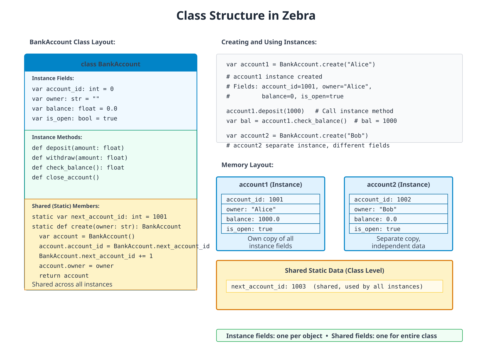

# 07: Classes and Instances

**Audience:** All (with beginner sidebar)  
**Time:** 120 minutes  
**Prerequisites:** 01-06  
**You'll learn:** Define classes, instantiate objects, instance methods, fields, initialization, cues (the methods the compiler calls for printing, `==`, hashing, ordering and `for`)

---

## The Big Picture

**Classes** are blueprints for objects. Instead of a loose collection of variables, a class groups related data and behavior together.

```
Real world: A car has properties (color, speed) and behaviors (accelerate, brake)
Code: A Car class has fields (color, speed) and methods (accelerate, brake)
```

---

## Defining Classes



### Simple Class

```zebra
# file: 07_class_basic.zbr
# teaches: class definition, cue init
# chapter: 07-Classes-and-Instances

class Person
    var name: str
    var age: int

    cue init(name: str, age: int)
        this.name = name
        this.age = age

    def greet()
        print("Hi, I'm ${this.name}")

def main()
    var person = Person("Alice", 30)
    person.greet()  # Hi, I'm Alice
```

**Breakdown:**
- `class Person` — Define a class named Person.
- `var name: str` — Field (property) of the class.
- `cue init(name, age)` — Constructor. `this.name = name` initialises the field from the argument of the same name (using `this.` to disambiguate).
- `def greet()` — Method of the class.
- `Person("Alice", 30)` — Create an instance, passing constructor args.

> The class fields don't need defaults when `cue init` always sets them. The "field default" form (`var name: str = ""`) shines when you want to allow construction without specifying every field — see "Fields and Initialization" below.

### Fields and Initialization

```zebra
# file: 07_init.zbr
# teaches: field defaults vs. explicit init
# chapter: 07-Classes-and-Instances

class Rectangle
    var width: int = 0      # Defaults — class is constructible with `Rectangle()`
    var height: int = 0

    def area(): int
        return this.width * this.height

def main()
    var rect = Rectangle()
    rect.width = 10
    rect.height = 5
    print(rect.area())  # 50
```

> Field defaults make a class **bare-constructible** (`Rectangle()` works) and let callers fill in only the fields they care about. Adding `cue init(width: int, height: int)` would make construction strict and let you drop the defaults — both styles compose.

### Instance Methods

```zebra
# file: 07_methods.zbr
# teaches: instance methods
# chapter: 07-Classes-and-Instances

class Counter
    var count: int = 0

    def increment()
        this.count = this.count + 1

    def decrement()
        this.count = this.count - 1

    def reset()
        this.count = 0

    def get_count(): int
        return this.count

def main()
    var counter = Counter()
    counter.increment()
    counter.increment()
    counter.increment()
    print(counter.get_count())  # 3
    counter.reset()
    print(counter.get_count())  # 0
```

### Static Methods (Class Methods)

```zebra
# file: 07_static.zbr
# teaches: static (class-level) methods
# chapter: 07-Classes-and-Instances

class MathUtil
    static
        def abs(x: int): int
            if x < 0
                return 0 - x
            return x

        def max_of(a: int, b: int): int
            if a > b
                return a
            return b

def main()
    print(MathUtil.abs(-5))  # 5
    print(MathUtil.max_of(10, 20))  # 20
```

> When the methods are pure and don't share state, you have a choice: group them on a class for namespacing (as above) or write them as plain top-level `def`s in a module. Pick the form that reads better at the call site. Top-level `def` keeps the call as `abs(-5)`; the class form makes `MathUtil.abs(-5)` self-documenting at a distance.

### If you're new to programming

> A **class** is like a template. When you create an instance (with `Person()`), you're making a specific copy from that template.
>
> **Fields** are the properties (like `name`, `age`)
>
> **Methods** are the behaviors (like `greet()`)
>
> **Instance methods** work on a specific object (`person.greet()`)
>
> **Static methods** belong to the class itself (`MathUtil.abs()`)

---

## Method Modifiers and Attributes

Three method-level attributes alter the generated code without changing
the method's signature:

```zebra
class Config
    @once
    def load(): str                  # body runs once; result cached on the instance
        return File.read("config.json")

    @profile
    def heavy_work()                 # body wrapped with Profile.start/end automatically
        # ...

    static
        @tag("unit", "fast")
        def test_defaults()          # tagged for filtered test runs
            assert Config().load() == "{}"
```

| Attribute | Effect |
|---|---|
| `@once` | First call runs the body and stores the result on the instance; subsequent calls return the cached value without re-running |
| `@profile` | Wraps the body with `Profile.start("Class.method")` / `defer Profile.end(...)`; requires the `Profile` stdlib module |
| `@tag("label", ...)` | Attaches one or more string tags to a `test_*` method for use with `zebra test --tag <label>` — see Chapter 22c |

`@once` is the most common — handy for expensive lazy initialisation
(loading a config file, building a lookup table) where you want the
caching to be invisible at the call site.

---

## `with` — Contextual Self

`with obj` makes `obj` the implicit receiver for **bare-name method
calls and field assignments** inside the block. It's a compile-time
textual rewrite — no runtime cost:

```zebra
with g
    text("Status: ready")        # → g.text("Status: ready")
    button("OK", .ok)            # → g.button("OK", .ok)
    x = 5                        # → g.x = 5
```

What's rewritten:

| Source | After rewrite |
|---|---|
| `method(args)` (statement position) | `obj.method(args)` |
| `field = value` | `obj.field = value` |

What's **not** rewritten:

- Statements nested inside `if`, `for`, `while`, `branch` inside the block — those still need the full `obj.method(...)` form.
- Expression positions — only top-level statements in the block are rewritten.

`with` is most useful for **GUI-style code** where you'd otherwise type
the same `g.` prefix on every line. It pairs naturally with `using` for
layout containers (Chapter 14b).

---

## Cues — Methods the Compiler Calls

You have already written one cue: `cue init`, the constructor. The word
`cue` marks a method that the **compiler** calls for you, at a place the
language defines. A `def` is a method that *your* code calls.

The set of cues is **closed**. There are exactly nine, and each one has
a call site:

| Cue | Shape | The compiler calls it for |
|---|---|---|
| `cue init(...)` | any parameters, no return type | `T(...)` (construction) |
| `cue toString(): str` | no parameters | `print(x)` and `"${x}"` |
| `cue equals(other: T): bool` | one parameter | `x == y`, `x != y` |
| `cue hash(): int` | no parameters; needs `cue equals` | `x` as a `HashMap(T, V)` key or a `Set(T)` element |
| `cue compare(other: T): int` | negative, zero, or positive; needs `cue equals` | `<` `<=` `>` `>=`, and `list.sort()` |
| `cue iter(): I` | `I` is a type that declares `cue next` | `for x in obj` |
| `cue next(): E?` | returns `nil` when there is nothing left | `for x in obj`, on `obj` itself or on what `iter()` returned |
| `cue begin()` / `cue end()` | no parameters, no return value | `using obj`: `begin` on entry to the block, `end` on the way out (Chapter 14b) |

`T` in `equals` and `compare` is the declaring type: `==` and `<` hand
the cue another value of the same type, so `cue equals(other: int)` is
refused where you write it.

A cue is still a method, so you can call it yourself (`a.equals(b)`,
`x.toString()`, `it.next()`). The `cue` keyword adds two things: the
compiler promises to call it at that site, and it checks the signature
against the shape in the table when you declare it, not later.

### If you know Python
> Cues are Python's dunder methods without the underscores: `__init__`,
> `__str__`, `__eq__`, `__hash__`, `__lt__` and friends, `__iter__`,
> `__next__`, and `__enter__` / `__exit__`, which Python's `with` statement
> calls (Zebra's `using`, not its `with`).
> Two differences. The set is closed, so you cannot invent a
> cue the way you can invent `__frobnicate__`. And one `compare` returning
> negative/zero/positive stands in for all four ordering operators.

### Printing, equality, hashing, ordering

```zebra
# file: 07_cues_money.zbr
# teaches: the toString, equals, hash and compare cues, and where the compiler calls them
# chapter: 07-Classes-and-Instances

class Money
    var cents: int

    cue init(cents: int)
        .cents = cents

    cue toString(): str
        var c = .cents % 100
        var pad = if(c < 10, "0", "")
        return "${.cents / 100}.${pad}${c}"

    cue equals(other: Money): bool
        return .cents == other.cents

    cue hash(): int
        return .cents

    cue compare(other: Money): int
        return .cents - other.cents

def main()
    var price = Money(1505)
    print(price)                       # toString
    print("Total: ${price}")           # toString again, inside ${}

    var same = Money(1505)
    print(price == same)               # equals: same value, two objects
    print(price != Money(99))

    print(price < Money(2000))         # compare
    var prices = List(Money)()
    prices.add(Money(2000))
    prices.add(price)
    prices.add(Money(5))
    prices.sort()                      # compare, once per comparison
    print(prices.at(0))

    var notes: HashMap(Money, str) = HashMap()
    notes.put(price, "lunch")
    print(notes.get(same)!)            # hash finds the slot, equals confirms it
    var seen: Set(Money) = Set()
    seen.add(price)
    seen.add(same)
    print(seen.count())
```

**Output:**
```
15.05
Total: 15.05
true
true
true
0.05
lunch
1
```

**What happened here:**
- `print(price)` and `"Total: ${price}"` both called `toString`.
- `price == same` called `equals`. `price` and `same` are two separate
  objects, and they compare equal because their *values* match.
- `<` and `sort()` called `compare`. A negative result means "this one
  comes first", so `sort()` puts the smallest amount at index 0.
- The `HashMap` called `hash` to find the slot and `equals` to confirm
  the key. That is why `notes.get(same)` finds the entry stored under
  `price`, and why the `Set` ends up holding one element, not two.

### Without cues, a class has identity

A class is a reference type: a variable holds a reference to an object,
and `var c = a` gives the same object a second name. With no
`cue equals`, `==` asks whether two names refer to the **same object**.
With no `cue hash`, a `HashMap` keys a class by identity too.

```zebra
# file: 07_cues_identity.zbr
# teaches: what == and HashMap keys mean for a class with no cues
# chapter: 07-Classes-and-Instances

class Ticket
    var seat: int

    cue init(seat: int)
        .seat = seat

def main()
    var a = Ticket(12)
    var b = Ticket(12)
    var c = a
    print(a == b)                      # two objects
    print(a == c)                      # one object, two names
    var holders: HashMap(Ticket, str) = HashMap()
    holders.put(a, "Ann")
    holders.put(b, "Bob")
    print(holders.count())             # keyed by identity
```

**Output:**
```
false
true
2
```

Identity is often what you want for an object that *is* something: a
connection, a service, a game entity. Add `equals` (and `hash`, if it will
be a key) when two separate objects with the same contents should count
as the same value, as `Money` does. Ordering has no default at all: `<`
and `sort()` on a class without `cue compare` do not build.

### Keep the cues consistent

The compiler checks each cue's *shape*, and it checks that the cues which
depend on each other come together: `cue hash` without `cue equals` is
refused, and so is `cue compare` without `cue equals`. What it cannot
check is that your cues *agree* with each other, so that part is up to
you:

- **Equal values must hash equally.** If `a == b`, then `a.hash()` must
  equal `b.hash()`, or a `HashMap` will look in the wrong slot and miss a
  key it holds. The safe rule: hash only fields that `equals` compares.
- **`compare` returns 0 exactly when `equals` is true.** Otherwise the
  operators disagree. Here `equals` looks at the student and the score,
  while `compare` looks only at the score:

```zebra
# file: 07_cues_consistency.zbr
# teaches: compare and equals must agree -- the compiler checks that both exist, not that they agree
# chapter: 07-Classes-and-Instances

class Grade
    var student: str
    var score: int

    cue init(student: str, score: int)
        .student = student
        .score = score

    cue equals(other: Grade): bool
        return .student == other.student and .score == other.score

    cue compare(other: Grade): int
        return .score - other.score

def main()
    var a = Grade("Ann", 90)
    var b = Grade("Bob", 90)
    print(a <= b)
    print(a >= b)
    print(a == b)
```

**Output:**
```
true
true
false
```

`a <= b` and `a >= b` both hold, yet `a == b` is false: `compare` says
the two grades tie, and `equals` says they differ. Make them tell the
same story. Either have `compare` break a tie on the student's name, or
have `equals` compare only `score`.

### Iteration: `cue iter` and `cue next`

`for x in obj` works on lists, ranges and maps (Chapters 03 and 05), and
on any type that declares these cues:

- `cue next(): E?` hands out the next element, or `nil` when there are no
  more. A type with `cue next` is its own iterator.
- `cue iter(): I` returns a separate iterator object, whose type `I`
  declares `cue next`. Each `for` loop calls `iter()` again and gets a
  fresh one.

```zebra
# file: 07_cues_iter.zbr
# teaches: cue iter and cue next -- making a type work in `for x in obj`
# chapter: 07-Classes-and-Instances

class Countdown
    var start: int

    cue init(start: int)
        .start = start

    cue iter(): CountdownIter          # a fresh iterator for each `for`
        return CountdownIter(.start)

class CountdownIter
    var n: int

    cue init(n: int)
        .n = n

    cue next(): int?                   # nil means "no more"
        if .n <= 0
            return nil
        .n = .n - 1
        return .n + 1

class Ticker                           # its own iterator: `cue next`, no `cue iter`
    var left: int

    cue init(left: int)
        .left = left

    cue next(): int?
        if .left <= 0
            return nil
        .left = .left - 1
        return .left + 1

def main()
    var launch = Countdown(3)
    for n in launch
        print("launch ${n}")
    for n in launch                    # iter() runs again: a fresh countdown
        print("again ${n}")

    var t = Ticker(2)
    for n in t
        print("tick ${n}")
    for n in t                         # t is used up: the body never runs
        print("never ${n}")
    else
        print("ticker exhausted")

    var manual = Ticker(1)
    print(manual.next()!)              # next() is callable by hand, too
    print(manual.next() == nil)
```

**Output:**
```
launch 3
launch 2
launch 1
again 3
again 2
again 1
tick 2
tick 1
ticker exhausted
1
true
```

The two shapes behave differently the second time round. `Countdown`
can be walked any number of times, because each loop asks it for a new
iterator. `Ticker` is used up after one pass, because the loop consumes
the object itself. Use `cue iter` for something that *holds* its
elements (a collection), and a lone `cue next` for something that
*produces* them once (a stream of tokens, lines from a reader).

Only the `cue` spelling makes a type iterable: a `def next()` or
`def iter()` is an ordinary method that `for` does not look at. (A
debugger client's `next()` is a command, not an iterator, which is why
the two spellings are kept apart.)

For most lazy sequences you will not write the iterator class at all. A
**generator** (Chapter 05), a `def` that returns `Iter(T)` and produces
values with `yield`, is compiled into a class with `cue next` for you.

### What is not a cue

- **`allocate` calls ordinary `def`s.** `allocate` uses an allocator
  source's `def allocator()` and `def deinit()` (Chapter 14b). Those are
  spelled `def`, and `cue deinit` is refused as an unknown cue. (`using`
  is different: its `begin` and `end` *are* cues, in the table above.)
- **A `def begin()` no `using` reaches is just a method.** Like
  `def next()`, a `def begin()` or `def end()` is an ordinary method until
  a `using` block meets it. Older code that spells a `using` resource's
  hooks `def begin()` / `def end()` still compiles in this release, with a
  deprecation warning at each `using`; a later release will refuse it.
- **There is no destructor.** Zebra 1.0 has no `cue deinit`; the compiler
  refuses it. Memory is reclaimed by the arena that owns it (Chapter 14b),
  and anything with a release step (a file, a lock, a layout group) goes
  in a `using` block.
- **`len` and `contains` are not cues.** A `def len(): int` on your type
  is an ordinary method; nothing in the language calls it for you.
- **There is no operator overloading.** `equals` gives you `==`, and
  `compare` gives you `<` `<=` `>` `>=`; nothing gives you `+`, `*`, or
  indexing with `obj[i]` on your own types. Write a named method
  (`a.plus(b)`, `bag.at(i)`).

---

## `@derive` — Auto-Generated Methods

For `struct` declarations, `@derive(Debug, Eq, Hash)` instructs the
compiler to auto-generate the `toString`, `equals`, and `hash` cues based
on the struct's fields:

```zebra
@derive(Debug, Eq, Hash)
struct Point
    var x: int
    var y: int

def main()
    var p = Point(x: 1, y: 2)
    var q = Point(x: 1, y: 2)
    print(p.toString())  # Point(x=1, y=2)
    print(p.equals(q))  # true (and p == q routes through it)
    print(p.hash() == q.hash())  # true
```

What each trait generates:

| Trait | Cue | Behaviour |
|---|---|---|
| `Debug` | `cue toString(): str` | `"TypeName(field=value, field=value, ...)"` |
| `Eq` | `cue equals(other: TypeName): bool` | Field-wise equality; `==` / `!=` route through it |
| `Hash` | `cue hash(): int` | Combines per-field hashes; consistent with `equals`. Every field must be hashable — a `float` field is not |

The traits are independent — derive any subset. Without `@derive`, you'd
write the cues by hand; with it, the compiler keeps them in sync as
you add or remove fields. A hand-written cue wins over the derived one.

These three are the `toString`, `equals` and `hash` cues from the
previous section, written for you. `@derive` does not write `compare`,
`iter` or `next`; write those by hand.

`@derive` is **struct-only**. For a class, write the cues explicitly, as
`Money` does above. A class has identity, and the field-by-field
default is rarely what its equality should mean.

---

## Real World: User Management

```zebra
# file: 07_user_system.zbr
# teaches: realistic class design
# chapter: 07-Classes-and-Instances

class User
    var username: str = ""
    var email: str = ""
    var created_at: str = ""
    var is_active: bool = true

    def is_valid(): bool
        return this.username.len > 0 and this.email.contains("@")

    def deactivate()
        this.is_active = false

    def display_profile()
        print("User: ${this.username}")
        print("Email: ${this.email}")
        print("Active: ${this.is_active}")

class UserManager
    static
        var users: List(User) = List(User)()

        def add_user(user: User): bool
            if not user.is_valid()
                return false
            UserManager.users.add(user)
            return true

        def find_user(username: str): User?
            for user in UserManager.users
                if user.username == username
                    return user
            return nil

        def user_count(): int
            return UserManager.users.count()

def main()
    var user1 = User()
    user1.username = "alice"
    user1.email = "alice@example.com"

    if UserManager.add_user(user1)
        print("User added")

    if UserManager.find_user("alice") as found
        found.display_profile()
```

---

## Common Patterns

### Value Object

```zebra
class Point
    var x: int = 0
    var y: int = 0

    def distance_from_origin(): float
        return 0.0  # sqrt(x*x + y*y) once you have a sqrt to call
```

### Service Class

```zebra
class EmailService
    static
        def send(to: str, subject: str, body: str): bool
            # Implementation
            return true
```

### Builder Pattern

```zebra
class UserBuilder
    var username: str = ""
    var email: str = ""
    var age: int = 0

    def with_username(name: str)
        this.username = name

    def with_email(addr: str)
        this.email = addr

    def build(): User
        var user = User()
        user.username = this.username
        user.email = this.email
        return user
```

---

## Common Mistakes

> ❌ **Mistake:** Forgetting to initialize fields
>
> ```zebra
> class Person
>     var name: str  # No default value
> var p = Person()
> print(p.name)  # ❌ Uninitialized!
> ```
>
> ✅ **Better:**
> ```zebra
> class Person
>     var name: str = ""  # Has default
> ```

> ❌ **Mistake:** Modifying shared fields unintentionally
>
> ```zebra
> class Counter
>     static var count: int = 0
>     
>     def reset
>         count = 0  # Affects ALL instances!
> ```
>
> ✅ **Better:**
> ```zebra
> class Counter
>     var count: int = 0  # Instance field
>     
>     def reset
>         count = 0  # Only this instance
> ```

> ❌ **Mistake:** Writing a cue as a `def`
>
> ```zebra
> class Widget
>     var n: int
>     cue init(n: int)
>         .n = n
>     def toString(): str
>         return "Widget(${.n})"
> ```
>
> 💡 **Why it's wrong:** `toString`, `equals`, `hash` and `compare` are found by
> name, so there is one spelling for each. The compiler refuses the `def` and names
> the fix:
>
> ```
> error: `toString` is a cue -- the compiler calls it for print and string interpolation -- so it is written `cue toString(): str`, not `def`
> ```
>
> The constructor is the same: `def init(...)` is refused with "the constructor is
> written `cue init(...)`, not `def init`".
>
> ✅ **Better:** `cue toString(): str`

> ❌ **Mistake:** A `hash` with no `equals`
>
> ```zebra
> class Key
>     var id: int
>     cue init(id: int)
>         .id = id
>     cue hash(): int
>         return .id
> ```
>
> 💡 **Why it's wrong:** a key is *found* by its hash and *confirmed* by `equals`. On
> its own, the hash would quietly leave the key compared by identity:
>
> ```
> error: `cue hash` needs `cue equals` on the same type (a HashMap key is looked up by hash, then confirmed by equals)
> ```
>
> ✅ **Better:** add `cue equals(other: Key): bool` comparing the same fields the
> hash uses.

> ❌ **Mistake:** A cue with the wrong shape
>
> ```zebra
> class Ver
>     var n: int
>     cue init(n: int)
>         .n = n
>     cue equals(other: Ver): bool
>         return .n == other.n
>     cue compare(other: Ver): bool    # "is this less?" -- the wrong question
>         return .n < other.n
> ```
>
> 💡 **Why it's wrong:** `compare` answers "before, same, or after" with one int, so
> one cue can drive all four operators and `sort()`. The shape is checked where you
> declare it:
>
> ```
> error: `cue compare` takes the other value and returns int (negative, zero, positive): `cue compare(other: Ver): int`
> ```
>
> ✅ **Better:** `return .n - other.n` from a `cue compare(other: Ver): int`.

> ❌ **Mistake:** A `compare` with no `equals`
>
> ```zebra
> class Score
>     var n: int
>     cue init(n: int)
>         .n = n
>     cue compare(other: Score): int
>         return .n - other.n
> ```
>
> 💡 **Why it's wrong:** with no `equals`, `==` would still mean "the same object",
> so two scores could be neither less nor greater than each other and still not
> equal. The compiler refuses the pair at the declaration:
>
> ```
> error: `cue compare` needs `cue equals` on the same type (otherwise `a <= b` and `a >= b` can both hold while `a == b` is false)
> ```
>
> ✅ **Better:** add `cue equals(other: Score): bool` comparing the same fields as
> `compare` (on a struct, `@derive(Eq)` counts).

> ❌ **Mistake:** Inventing a cue (or looking for a destructor)
>
> ```zebra
> class Connection
>     var open: bool = true
>     cue deinit()
>         .open = false
> ```
>
> 💡 **Why it's wrong:** the nine cues are the whole set. Anything else is refused,
> `deinit` included:
>
> ```
> error: unknown cue 'deinit': the cues are init, toString, equals, hash, compare, iter, next, begin, end (a method the compiler calls for you; anything else is a `def`)
> ```
>
> ✅ **Better:** for a release step, give the class `cue begin()` / `cue end()` and
> use it in a `using` block (Chapter 14b). For any other method, write `def`.

> ❌ **Mistake:** `using` hooks written as `def`
>
> ```zebra
> class Section
>     def begin()
>         print("start")
>     def end()
>         print("stop")
>
> def main()
>     using Section()
>         print("work")
> ```
>
> 💡 **Why it's wrong:** `using` calls `begin` and `end` for you, so they are cues.
> Code written before they were still builds and runs, but every `using` that
> reaches the `def` pair prints a warning, and a later release will refuse it:
>
> ```
> warning: type 'Section' used in 'using' declares begin/end with `def`; they are cues now -- write `cue begin()` and `cue end()` (`def` is deprecated here and will be refused)
> ```
>
> ✅ **Better:** `cue begin()` and `cue end()`.

---

## Exercises

### Exercise 1: Bank Account

Create a BankAccount class with deposit and withdraw methods:

<details>
<summary>Solution</summary>

```zebra
class BankAccount
    var balance: float = 0.0
    var account_number: str = ""

    def deposit(amount: float)
        this.balance = this.balance + amount

    def withdraw(amount: float): bool
        if amount > this.balance
            return false
        this.balance = this.balance - amount
        return true

    def get_balance(): float
        return this.balance

def main()
    var account = BankAccount()
    account.account_number = "1234567890"
    account.deposit(1000.0)
    print("Balance: ${account.get_balance()}")
    account.withdraw(100.0)
    print("Balance: ${account.get_balance()}")
```

</details>

### Exercise 2: Product Catalog

Create a Product class and a simple store:

<details>
<summary>Solution</summary>

```zebra
class Product
    var name: str = ""
    var price: float = 0.0
    var quantity: int = 0

    def total_value(): float
        return this.price * @as(f64, @floatFromInt(this.quantity))

class Store
    var products: List(Product) = List(Product)()

    def add_product(product: Product)
        this.products.add(product)

    def total_inventory_value(): float
        var total = 0.0
        for product in this.products
            total = total + product.total_value()
        return total

def main()
    var store = Store()

    var apple = Product()
    apple.name = "Apple"
    apple.price = 0.50
    apple.quantity = 100
    store.add_product(apple)

    var orange = Product()
    orange.name = "Orange"
    orange.price = 0.75
    orange.quantity = 80
    store.add_product(orange)

    print("Total value: ${store.total_inventory_value()}")
```

> The `@as(f64, @floatFromInt(this.quantity))` is a temporary float-from-int cast — Zebra's `int * float` doesn't auto-promote (mixed-type arithmetic is rejected, by design). Once a typed `float(int)` builtin lands, that escape hatch becomes a clean conversion.

</details>

---

## Next Steps

- → **08-Interfaces** — Contracts for classes
- → **09-Inheritance** — Class hierarchies
- 🏋 **Project-2-HTTP-Server** — Use classes extensively

---

## Key Takeaways

- **Classes group data and behavior** — Fields + methods
- **Instances are references** — Each `Person()` is a new object, but `var b = a` gives the *same* object a second name
- **Cues are the methods the compiler calls** — `init`, `toString`, `equals`, `hash`, `compare`, `iter`, `next`, and `begin` / `end` for `using`; the set is closed, and there is no `cue deinit`
- **`==` on a class is identity** unless the class has `cue equals`; a `HashMap` key needs `cue hash` *and* `cue equals`, ordering needs `cue compare` *and* `cue equals`, and they must agree
- **Instance methods** work on specific objects
- **Shared methods** belong to the class, not instances
- **Initialize fields** — Don't leave them undefined
- **Methods should have clear names** — `deposit()` not `d()`

---

**Next:** Head to **08-Interfaces** to define contracts between classes.
